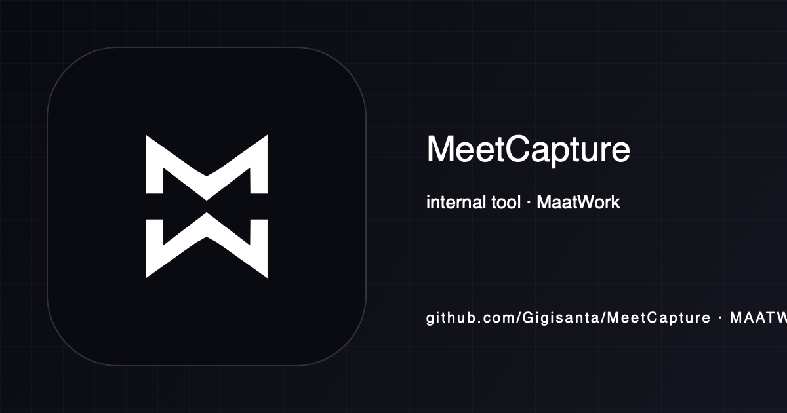

<!-- maatwork-brand:maatwork-mw-20260901 -->
<p align="center"></p>

# MeetCapture

MeetCapture is a native macOS menu-bar app for recording calls, transcribing
them locally, and keeping the resulting meeting history on the Mac. It has no
main window or Dock icon. Opening the app from Finder or Spotlight shows its
controls below the menu-bar icon; later, click that icon to reopen them.
Opening the app again while it is running also shows the controls. It is one
native process with no Python: transcription and speaker labels run in-process
on the Neural Engine through [FluidAudio](https://github.com/FluidInference/FluidAudio),
so they do not compete with a local LLM for the GPU. Summary generation uses a
separate Python dispatcher; its default MLX route is the local gateway at
`http://127.0.0.1:8080/v1`, unless you configure another endpoint.

Website: https://meetcapture.maat.work

## What it does

- **Local capture.** A Core Audio process tap records the call app and the
  microphone into 16 kHz Int16 stereo PCM. In the normal two-track layout,
  left is system audio and right is the microphone; microphone-only mode
  carries the microphone on both channels.
- **Transcript after the call.** There is no live transcription. After
  capture, each channel is transcribed separately with NVIDIA Parakeet TDT
  0.6B in ~5 min chunks, checkpointed per channel so a crash or quit resumes
  instead of starting over. Where the remote voice leaks from the speakers
  into the microphone, a bleed gate mutes it before transcription. The model
  is recorded in the handoff.
- **Speaker labels.** The microphone channel is labeled `Gio`. With "Identificar
  hablantes" on (macOS 15 or newer), the call channel is diarized into
  `Participante 1`, `Participante 2`… by order of appearance; otherwise it is
  one `Participante`. Transcript lines read `[Gio]: text`.
- **Summaries.** The canonical dispatcher at
  `tools/summary/meetcapture_summary_dispatcher.py` consumes each `.pending`
  handoff and writes JSON, HTML and a portable Markdown note with decisions,
  checkable pending tasks and the full transcript. The history row opens the
  Markdown note when it is ready. While recording, you can type private notes
  in the popover; they are saved alongside the meeting and included as context
  in the generated note. It uses the configured
  OpenAI-compatible endpoint and can run in `dry_run` mode.
- **History.** SQLite history with full-text search is shown in the popover.
  Audio can be imported or an existing recording can be re-transcribed.

Raw audio is retained until the transcript, history row, processing marker
and `.pending` handoff are durable. The app then applies its retention policy;
the summary dispatcher removes handoff audio after a successful summary unless
`keep_audio` is enabled.

## Requirements

- Apple Silicon Mac, macOS 14.4 or newer; speaker diarization needs macOS 15.
- Network once: `install.sh` downloads the speech models (about 0.6 GB) to
  `~/Library/Application Support/FluidAudio/`; otherwise they download on
  first use.
- Permissions when requested: Microphone, Screen and System Audio Recording,
  Calendar, and Notifications. Calendar auto-recording is optional.

## Install

```bash
git clone https://github.com/Gigisanta/MeetCapture.git
cd MeetCapture
./install.sh
```

`install.sh` builds and verifies a staging bundle, backs up the current local
bundle, installs to `~/meetings/MeetCapture.app`, then launches and checks the
exact installed process. It restores the previous bundle if installation or
launch verification fails. Finish any recording and quit the running app before
updating; the installer refuses to replace a live bundle. It checks for recent
recordings before building and again immediately before the swap, and refuses
installation if that inspection fails. Backups are kept as zipped bundles in
`~/meetings/.backups/` for manual recovery. Run `qa/app-smoke-test.sh` and the real
pipeline checks separately; a successful launch alone does not prove capture,
transcription, import, SQLite publication, or summary delivery.

## Configuration

Personal configuration stays outside the repository in `~/.meetcapture/`:

- `config.json` (see `Resources/config.example.json`) contains
  `whitelistedEmails` and optional `aliases`, which map a canonical spelling
  to what the recognizer writes instead, for example
  `{"AppSheet": ["app sheet"], "CEDEAR": ["cedear", "sedear"]}`. Aliases
  replace whole words, ignore case, and apply to the merged transcript.
  Settings › Calendario opens it.
- `summary.json` contains `endpoint`, `api_key`, `model`, `max_tokens`,
  `keep_audio`, `dry_run`, and optional `tag_vocabulary_dir`. Settings › Resumen
  edits it. When a Markdown notes directory is configured, the dispatcher
  reads existing tags from it and only accepts tags from that vocabulary;
  the directory contents are not copied to the summary endpoint. Keep any real
  credential there; never put it in the repository or a test fixture.

Models are downloaded at runtime and are never bundled from this repository.
Their licenses and the required attribution are in
[`docs/THIRD_PARTY.md`](docs/THIRD_PARTY.md).

## Summaries

The canonical summary implementation is the Python dispatcher in the nested
`tools/summary/` directory. The optional per-user launchd agent is
`ai.hermes.meetcapture-summary` and only schedules that dispatcher. Its
installer refuses to proceed if the legacy plist or a loaded
`com.maatwork.meetcapture-summary` agent exists; migrating that live service is
a separate operational action. It does not unload or kill the legacy service,
and it does not update an existing host-level legacy parent binary:

```bash
tools/summary/install-summary-agent.sh
python3 tools/summary/meetcapture_summary_dispatcher.py --once
python3 tools/summary/meetcapture_summary_dispatcher.py --retry-failed
```

See [`tools/summary/README.md`](tools/summary/README.md) for the handoff
states and retry behavior. The retired `com.maatwork.meetcapture.daemon`
launchd service is not part of the current architecture and must not be
re-enabled.

## Build without installing

```bash
./build.sh --staging-dir /tmp/meetcapture-stage
codesign --verify --deep --strict /tmp/meetcapture-stage/MeetCapture.app
```

Local builds are ad-hoc signed. Developer ID signing and notarization are
separate distribution steps.

## Tests and evidence boundaries

```bash
swift test
MEETCAPTURE_APP=/tmp/meetcapture-stage/MeetCapture.app qa/app-smoke-test.sh
python3 tools/summary/test_dispatcher.py
python3 tools/summary/test_real_summary_check.py
scripts/version.sh --check
```

`swift test` covers pure policies, contracts, stores, and process fixtures in
temporary locations. The two summary tests cover dispatcher lifecycle and the
offline content gate with temporary fixtures; they do not call the configured
gateway. The smoke check verifies the selected bundle, signing, bundled
resources, a render, and normal app launch from that exact binary. Version consistency is checked
separately by `scripts/version.sh --check`.

`qa/app-smoke-test.sh` verifies the selected bundle, signing, bundled
resources, a synthetic popover render and process liveness when LaunchServices
starts the native AppKit app. Its guarded `/tmp` launch probe checks the
status button, opening on launch, click to close, and Finder reopen. On macOS
26, run it with `MEETCAPTURE_REQUIRE_HOSTED_ICON=1` while other MeetCapture
instances are closed: the probe then requires a new on-screen Control Center
window aligned with its status button. A plain `isVisible` value does not
establish this, and the geometric check does not cover every display or Space.
The render uses
`PopoverSnapshot` and synthetic `UIFixtureState`; the
probe skips operational startup, permissions, capture, meeting writes and the
summary dispatcher.

`qa/visual-test.sh --headless` has the same fixture boundary. Its interactive
mode is a screenshot check of the normal popover and is visual evidence only.
`qa/capture-selftest.sh` is the real app wrapper for
`import` and `capture`, while the `ui` mode is launched from the separate QA
bundle and exercised by CUA. The real `ui` mode below replaces the
`PopoverSnapshot` fixture for functional UI evidence; snapshots remain an
appearance check only.

The import/capture wrapper takes the original reference text with
`--reference`, checks every reported record and the latest report text against
that reference, and uses `MEETCAPTURE_MAX_WER=0.15` by default (`--max-wer`
overrides it). For `capture`, the wrapper computes the recorded duration from
the returned PCM and its format sidecar, independently of the input WAV. It
keeps the disposable output directory so the report and artifacts can be
inspected after the run.

### Real pipeline check contract

The real pipeline and UI harness share one opt-in interface. The QA wrapper
supplies the CLI for `import` and `capture`; the `ui` mode is driven from the
separate QA bundle with CUA. The interface is:

- `MEETCAPTURE_REAL_CHECK=import|capture|ui` selects the check before normal
  startup. The selected check omits automatic operations and calendar
  detection. `import` and `capture` exit after their pipeline; `ui` stays open
  for manual interaction until the user presses the Quit button.
- `MEETCAPTURE_TEST_OUTPUT_DIR` is mandatory and must point to a new temporary
  directory that is completely empty. The harness rejects any existing entry,
  not only an existing database or report. All generated meeting files, SQLite
  state, reports, and test artifacts stay there.
- `MEETCAPTURE_CHECK_INPUT` is the input WAV. The capture case feeds that
  known WAV through `afplay`; the import case uses it as the source for the
  import flow.
- `MEETCAPTURE_CHECK_REPORT` is a JSON report path inside
  `MEETCAPTURE_TEST_OUTPUT_DIR`.
- `MEETCAPTURE_CHECK_MIC_ONLY=1` opts the `capture` case into microphone-only
  mixing and makes the report carry `micOnly:true`; its default is `false`, so
  the normal contract remains microphone plus system audio.
- The import case exercises two imports and one re-transcription through real
  AppState, SQLite, and `.pending` publication.
- The capture case exercises AppState, AV/Core Audio, `afplay`, a real PCM
  recording with its format sidecar, the per-channel WAV split, and Parakeet
  itself. The models must already be downloaded or the first run needs
  network. Diarization is explicitly disabled here. If microphone permission
  blocks the run, classify it as exit `77` and do not claim a real-call result.
- The `ui` case opens `PopoverContent` with real `AppState`, real engines,
  isolated history, and volatile settings, with `allowsSettings:false` so
  `SettingsView` cannot read or write normal preferences. CUA exercises the
  known-WAV `NSOpenPanel` import, re-transcription, search matches and
  non-matches, and error recovery, then closes through Quit. It does not enter
  Settings or normal startup. The required report path guards the fresh run;
  the manual verifier must save `ui-evidence.json` under the output directory.
  The app does not auto-report or emit a pipeline PASS.
- Exit `0` means the requested pipeline completed. Exit `77` means a required
  prerequisite blocked the check. Exit `1` means the pipeline failed. The
  import/capture wrapper additionally validates the WER/reference result; an
  app exit of `0` alone is not a WER pass. UI evidence is decided by the
  separate manual review and never by a counter in the report.

The real UI run uses a separate bundle QA identifier and CUA interaction. It
supersedes the synthetic `UIFixtureState` for functional controls and manual
import, while `PopoverSnapshot` remains the appearance-only path.

`qa/capture-selftest.sh` supplies the reproducible CLI for `import` and
`capture`, including reference/WER validation. The `ui` mode uses the same
environment guard from the separate QA bundle and CUA driver. No result or
PASS is inferred from fixture counts; the local evidence and unresolved limits
are recorded in `CHANGELOG.md`. The legacy duration-based self-test is not a
substitute because an error must not become a successful check.

A real transcription that produces no segments is exit `1`; it publishes no
`.pending` handoff and retains its input audio for diagnosis or retry.

See [`qa/README.md`](qa/README.md) for the current check matrix and
[`docs/ARCHITECTURE.md`](docs/ARCHITECTURE.md) for the data-flow contracts.

## Troubleshooting

1. **No menu-bar icon.** Open System Settings › Menu Bar and check that
   MeetCapture is enabled under “Allow in the Menu Bar.” If you use multiple
   displays, check the menu bar on the active display too. Quit MeetCapture
   before reinstalling with `./install.sh`; the installer refuses to replace
   a running bundle. On macOS 26, run the strict hosted-icon smoke check above
   to separate an on-screen item from an AppKit-only proxy.
2. **No transcript on the first meeting.** The speech models download at
   install or on first use; a failed download keeps the audio. Check the network: recent
   recordings are retried at the next launch, older ones with "Transcribir".
3. **Everyone on the call is one `Participante`.** Enable "Identificar
   hablantes" in Settings › ASR. Diarization is skipped on macOS 14.
4. **A handoff remains in retry or failed state.** Inspect the endpoint in
   `~/.meetcapture/summary.json` and the private summary log; use
   `--retry-failed` only after fixing the underlying cause.
5. **The left channel is silent.** Grant Screen and System Audio Recording in
   System Settings › Privacy and restart the app; the process tap requires it.
   A meeting whose system channel stayed silent is transcribed from the
   microphone alone.

## License

MIT. See `LICENSE`.
